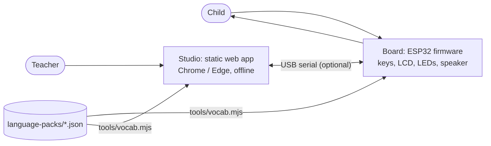

# VaaniBoard

An offline, personalised AAC (augmentative and alternative communication) board for non-verbal and minimally verbal children. Each key speaks a word in the child's home language, in a voice recorded by their teacher or parent. Optional listening assistance lights the likely answers to a teacher's question. The board never needs internet, an app or a phone.

Vishwakarma Awards 2026-27 · Assistive Solutions · Application ID **VK26-IITI-AS-0216**
Team: Arshpreet Sukhdeep Singh Dhillon, Payal Priyadarshini Sahoo, Anusha Sharma

> **Status (October 2026, firmware 0.2.0 / Studio 0.2.0).** Breadboard prototype on a classic ESP32 DevKit plus the VaaniBoard Studio web app. Software is built and tested on a laptop and in CI (192 automated tests). **Firmware 0.2.0 has not yet been run on the physical board**: see [Current limitations](#21-current-limitations). Listening is simulated; there is no microphone or keyword model yet.

---

## 1. Overview
VaaniBoard is two things:
- **The board** (essential): ESP32 firmware that reads big keys, speaks words, shows them on an LCD and lights LEDs. It works on its own from a USB power bank.
- **VaaniBoard Studio** (optional): a web app on the teacher's laptop that sets the board up over the USB cable and shows what the child said. It includes a simulator, so it can be tried with no hardware.

## 2. Problem and solution
**Problem.** Children who cannot speak need to ask for water, say they are in pain, or refuse something. Commercial AAC devices are expensive, need tablets and internet, and rarely speak Hindi, Tamil or Bengali in a familiar voice.
**Solution.** A low-cost physical board with fixed, always-working Yes / No / Help / Stop keys and vocabulary keys that play recordings made by the child's own teacher or parent. Big-switch scanning serves children who cannot press small keys, and settings can be changed with a magnet, no laptop needed.

## 3. Key features (implemented)
| | Feature |
|---|---|
| Communication | Core row Yes / No / Help / Stop that is never highlighted, dimmed or remapped; 4- or 8-key builds; recorded voice per language, beep fallback |
| Safe input | 30 ms debounce, hold-to-speak 0-1000 ms, per-key repeat lockout, palm rejection (3+ keys ignored) |
| Access | Direct press, or switch scanning with one big switch (suggested keys first, then the core row) |
| Personal | Per-child profile (code, language, access, timings, volume capped at 80 %, listening on/off) saved on the board |
| Caregiver mode | Magnet on a hidden reed switch turns the keys into settings keys; ends on its own after 2 minutes |
| Listening assistance | A key lights only after two confident (≥ 0.8) keyword results in a row, fades after 10 s, never speaks or selects. **Simulated** in Studio for now |
| Studio | Dashboard, live board, profiles, vocabulary packs, voice clips, simulated listening, history + CSV, diagnostics, simulator |
| Accessibility (Studio) | Keyboard-only use, screen-reader labels and announcements, visible focus, high contrast, larger text, reduced motion |
| Multilingual | Hindi, Tamil, Bengali, Marathi, Punjabi, Odia, English vocabulary from JSON language packs; add a language without code changes |

## 4. Target users and use cases
- **Children** aged roughly 3-12 who are non-verbal or minimally verbal (autism, cerebral palsy, apraxia), including those who need switch access.
- **Special educators and parents** who set the board up, record voices and review which words are used.
- Use cases: daily needs in class (water, food, toilet, pain); answering yes/no questions; asking for help or saying stop; recording which words a child uses so the vocabulary can be adjusted.

## 5. Architecture

No backend, database server, cloud service or account is involved: the board keeps the only data communication needs, and Studio keeps its own small data in the browser.

| Folder | What |
|---|---|
| `firmware/board/` | ESP32 firmware (PlatformIO, Arduino). `src/` hardware layer, `lib/vaani_core/` hardware-free logic, `test_host/` laptop tests, `data/` voice clips (not committed) |
| `studio/` | VaaniBoard Studio (Next.js 14 static export, React 18, Web Serial) with `test/` |
| `language-packs/` | Vocabulary source of truth: `keys.json` + one file per language |
| `tools/vocab.mjs` | Validates packs and generates the firmware and Studio vocabulary |
| `tests/vectors/` | Rule test cases shared by the firmware and simulator tests |
| `sample-data/` | Fictional profiles, demo events, example language packs |
| `cad/` | CadQuery model, STEP/STL, keyguard DXF, A3 drawing, renders |

## 6. Prerequisites
**Software:** Git; Node.js 20 or newer (tested with 24.22); for firmware, PlatformIO Core 6.2 (`pip install platformio==6.2.0`, or the PlatformIO IDE extension for VS Code); for firmware host tests, a C++17 compiler (`g++`, `clang++`, or `pip install ziglang` → `zig c++`).
**Hardware (optional):** ESP32 DevKit (WROOM-32), 5 push buttons (9 for the 8-key build), LEDs, 220 Ω and 10 kΩ resistors, 16×2 I2C LCD, buzzer, reed switch + magnet, breadboards; optional PAM8403 amplifier and speaker. Wiring: see [Wiring](#wiring-4-key-build) below.

## 7. Supported systems and browsers
| | Supported |
|---|---|
| Studio with a board | **Chrome or Edge** (desktop, version 89+) on Windows, macOS, Linux or ChromeOS, opened from `http://localhost` (Web Serial needs a secure context) |
| Studio without a board (simulator, profiles, vocabulary, voices, history) | Any current browser, including Firefox and Safari |
| Firmware build | Windows, macOS, Linux (PlatformIO) |
| USB driver | Silicon Labs CP210x (or CH340, depending on the DevKit) |

## 8. Installation
```bash
git clone https://github.com/payal-priyadarshini-sahoo-pps/vaaniboard.git
cd vaaniboard
cd studio && npm ci && cd ..
pip install platformio==6.2.0        # only for firmware work
```
Optional, to keep the Next.js CLI from sending anonymous usage data while you develop: `cd studio && npx next telemetry disable`.

## 9. Environment variables
None are needed. VaaniBoard has no API keys, secrets or servers, so there is no `.env.example`. `PORT` is the only variable read (by `npm start`, default 3000). CI sets `NEXT_TELEMETRY_DISABLED=1`.

## 10. Studio: run and build
```bash
cd studio
npm run dev        # development: http://localhost:3000
npm run build      # static export to studio/out/
npm start          # serve studio/out/ on http://localhost:3000 (offline, localhost only, no extra packages)
npm run lint
npm test
```
Open **http://localhost:3000** in Chrome or Edge. Click **Connect board** and choose the CP210x port, or **Use simulator**. Close any PlatformIO / Arduino serial monitor first: only one program can use the port.

## 11-12. Backend and database
There is no backend and no database. The board keeps its profile in its own flash; Studio keeps profiles, settings and (only if you opt in) the event history in the browser's `localStorage`, with JSON and CSV export for backup.

## 13. Firmware: build and flash
```bash
cd firmware/board
pio run                              # builds esp32dev (4 keys) and esp32dev_8keys
pio run -e esp32dev -t upload        # flash the 4-key build (hold BOOT if it stalls at "Connecting...")
pio run -e esp32dev_8keys -t upload  # or the 8-key build
pio device monitor                   # 115200 baud
```
Expected on the monitor after a reset:
```
OK lcd at 0x27
HELLO vaaniboard 0.2.0 keys=4 fs=none proto=1
CFG {"child":"C01","lang":"hi","mode":"direct","hold_ms":0,"lockout_ms":1500,"scan_ms":1500,"volume":60,"listening":true,"keys":4,"fw":"0.2.0","proto":1,"langs":["hi","ta","bn"]}
```
(These lines are what the code prints; they have not yet been captured from a board running 0.2.0.) Serial commands: [below](#serial-commands-115200-baud-one-line-each). Pin map: `firmware/board/src/pins.h` and [Wiring](#wiring-4-key-build).

## 14. Simulator
Studio → **Use simulator** (header) or Home → **Simulator, 8 keys / 4 keys**. The simulator runs the board's rules in the browser and answers the same serial commands, so every tab works. Everything it produces is marked **SIMULATOR** on screen and `simulator` in History and in CSV exports. Diagnostics → **Simulate USB unplug** shows how Studio handles a pulled cable.

## 15. Connecting a physical board
1. Wire it as in [Wiring](#wiring-4-key-build) and flash it (§13 above).
2. Close the serial monitor. Run Studio (§10) and open it in Chrome or Edge.
3. **Connect board** → pick the CP210x / USB serial port. Home shows firmware, protocol, keys, languages and which voice clips are on the board.
4. Unplugging is safe: the board keeps working, and Studio reconnects when the same port comes back.

## 16. Vocabulary, languages and voice clips
- **Languages:** Hindi (`hi`), Tamil (`ta`), Bengali (`bn`): 8 words each.

  | | hi | ta | bn |
  |---|---|---|---|
  | LCD transliteration | 8/8, team-authored | 8/8, team-authored | 8/8, team-authored |
  | Native script (Studio) | 8/8, **unverified** | 8/8, **unverified** | 8/8, **unverified** |
  | Recorded speech | none shipped (record your own) | none shipped | none shipped |
  | Text-to-speech / speech recognition | not implemented | not implemented | not implemented |

  Native-script labels need review by a native speaker before classroom use. `node tools/vocab.mjs report` prints the current state.
- **Change or add words/languages:** edit `language-packs/*.json` (see `hi.json` for the format), then `node tools/vocab.mjs gen` and re-flash. Studio → Vocabulary can edit a copy, import or export a pack and validate it first. To add a language, create `language-packs/<code>.json`, add the code to `keys.json` `languages`, regenerate and rebuild. No code changes.
- **Voice clips:** Studio → Voices → record (or import) each word, check the result, download `NN.wav`, save it to `firmware/board/data/<lang>/`, then `pio run -e esp32dev -t uploadfs`. Board format: mono PCM, 8 or 16-bit, 4-22.05 kHz, ≤ 3 s. Recordings are git-ignored; never commit them, and never record the child.

## 17. Tests
```bash
node tools/vocab.mjs check                              # vocabulary in sync
cd studio && npm test                                   # 162 tests: unit, simulator, links, jsdom workflows
cd firmware/board && pio run && bash test_host/run.sh   # firmware builds + 30 host tests (CXX=g++ by default)
```
Without `g++` (e.g. Windows): `pip install ziglang`, then `CXX="py -m ziglang c++" bash test_host/run.sh` from Git Bash (`python3 -m ziglang c++` elsewhere).

## 18. Sample data and expected results
| File | Use | Expected |
|---|---|---|
| `sample-data/profiles/sample-profiles.json` | Studio → Profiles → Import | 3 profiles imported (S01-S03); S04 skipped (volume 95 > 80) |
| `sample-data/events/demo-session.json` | Studio → History → Load fictional demo session | 13 events marked `demo`: 8 words, 4 by switch, 2 highlights, 1 palm |
| `sample-data/language-packs/mr-partial.json` | Studio → Vocabulary → Import pack, or `node tools/vocab.mjs validate …` | Imported with warnings; missing keys show their English meaning |
| `sample-data/language-packs/invalid-example.json` | same | Rejected with 5 errors |

All sample data is fictional.

## 19. Troubleshooting
| Problem | Fix |
|---|---|
| "Connect board" greyed out | Use Chrome or Edge; Firefox and Safari have no Web Serial |
| No COM port | Install the CP210x driver; try a data (not charge-only) USB cable |
| "Port could not be opened" | Close the PlatformIO / Arduino serial monitor and other Studio tabs |
| Connected but no reply | Press EN/RESET on the ESP32; check it runs VaaniBoard firmware (Diagnostics shows details) |
| `WARN set …` after sending a profile | The board refused or clamped that field; the rest was saved |
| Keys beep instead of speaking | No clip for that key and language; upload clips (§16) |
| `test_host/run.sh`: ArduinoJson not found | Run `pio run` (or `pio pkg install -e esp32dev`) in `firmware/board` first |
| Firmware build on Windows: `fatal error: …: No such file or directory` for a file that exists | Windows 260-character path limit. Keep the project in a short folder (e.g. `C:\dev\vaaniboard`) or set `PLATFORMIO_WORKSPACE_DIR` to a short folder |
More in Studio → Diagnostics.

## 20. Security, privacy and offline behaviour
Only a child code (like `C01`) is stored, never a name. No audio of the child is recorded. Nothing leaves the laptop or the board: the Studio page makes no network requests and `npm start` serves it on localhost only. Voice clips, exported logs and profiles are git-ignored. To delete data: Profiles → Delete, History → Clear, or clear the site data in the browser; `reset` on the board.

## 21. Current limitations
- **Not yet hardware-verified:** firmware 0.2.0 compiles for both builds and its logic passes laptop tests, but it has not been run on the breadboard. Run the checks in [Before a demo](#before-a-demo-on-the-board) once the board is built.
- Listening is simulated in Studio: no INMP441 microphone or keyword model yet.
- Native-script labels are unverified; Studio's own interface is English only; no text-to-speech.
- No voice clips ship with the repository.
- Event times are milliseconds since the board started (no real-time clock).
- Studio data lives in one browser profile; clearing site data removes it (export first).
- Not built yet: 16-key board, WS2812B lights, I2S amplifier, microSD, battery, 3D-printed housing (designs in `cad/`).

## Wiring (4-key build)
Unplug USB while wiring. ESP32 pins are 3.3 V only. Every button uses two diagonally opposite legs: one to the GPIO, one to GND (no resistors; the firmware enables internal pull-ups). All GNDs share one rail.

| GPIO | Connect | GPIO | Connect |
|---|---|---|---|
| 32 | Key 1 Yes (button → GND) | 16 | LED 1 (220 Ω → LED → GND) |
| 33 | Key 2 No | 17 | LED 2 |
| 27 | Key 3 Help | 18 | LED 3 |
| 13 | Key 4 Stop | 19 | LED 4 |
| 14 | Access switch (button → GND) | 2 | Status LED (on the DevKit) |
| 4 | Reed switch → GND (module: DO; VCC → 3V3) | 23 | Active buzzer + (− → GND) |
| 21 / 22 | LCD I2C SDA / SCL (LCD VCC → VIN 5 V) | 25 | Optional: 10 kΩ → PAM8403 L input |

8-key build: keys 5-8 on GPIO 34, 35, 36, 39, each with a 10 kΩ pull-up to 3V3; LEDs 5-8 on GPIO 5, 26, 15, 2. Flash `esp32dev_8keys`. If caregiver mode is on when the magnet is away, set `REED_ACTIVE_LOW = false` in `firmware/board/src/pins.h`. If the LCD is lit but blank, turn the contrast screw on its I2C backpack.

## Serial commands (115200 baud, one line each)
| Command | Reply |
|---|---|
| `ping` | `OK vaaniboard <fw> keys=<n> proto=1` |
| `cfg` | `CFG {json}`: the current profile |
| `info` | `INFO {json}`: capabilities and which voice clips are on the board |
| `set {json}` | applies valid fields, e.g. `set {"lang":"ta","mode":"scan"}`; `WARN set <field>: …` for rejected ones; then `CFG` |
| `press <n>` / `switch` | simulates key n / the access switch (logged as input `sim`) |
| `kw <word> <0-1>` | a listening keyword result; two ≥ 0.8 in a row light the key for 10 s |
| `clear` / `reset` / `help` | clear highlights / restore defaults / list commands |

The board prints `HELLO …` at boot and `EVT,<ms>,<child>,<event>,<key>,<word>,<lang>,<input>` for every selection, highlight, palm press and caregiver change; `HL <keys>` for highlights, `CUR <key>` for the scan cursor, and `OK` / `WARN` / `ERR` replies. Lines over 255 characters and invalid commands are rejected and change nothing.

## Before a demo on the board
Run once on the built board with Studio connected (or `pio device monitor`):
1. Power on: LEDs light in turn; LCD `VaaniBoard  HI` / `DIRECT   LISTEN`; `HELLO vaaniboard 0.2.0 … proto=1`.
2. Each core key: LCD word, LED flash, 1 beep (Yes/No) or 3 beeps (Help/Stop); an `EVT … select …` line.
3. Press Yes five times quickly: it speaks once. Three keys at once: nothing, `palm` logged.
4. `set {"mode":"scan"}`: the cursor steps every 1.5 s; the access switch speaks the lit key.
5. Magnet on the reed switch: `CAREGIVER MODE`; remove it: settings saved. Left on for 2 minutes: the keys come back by themselves.
6. Unplug USB with the board on a power bank: keys keep working; plug back in: Studio reconnects.

## 22. License and contributing
Software (firmware, Studio, tools, tests, CAD scripts): **MIT** ([`LICENSE`](LICENSE)). CAD hardware files: **CERN-OHL-P-2.0**. Documentation, vocabulary and sample data: **CC BY 4.0**. Details and third-party components: [`LICENSES/README.md`](LICENSES/README.md). Contributions are welcome through pull requests.

## 23. Documentation
[Wiring](#wiring-4-key-build) · [Serial commands](#serial-commands-115200-baud-one-line-each) · [Before a demo](#before-a-demo-on-the-board) · [CAD](cad/README.md) · [Licences](LICENSES/README.md) · [Shared test vectors](tests/README.md)

## 24. Links
- Repository: https://github.com/arshpreet-svg/vaaniboard (team) · mirror: https://github.com/payal-priyadarshini-sahoo-pps/vaaniboard
- Demo video: not recorded yet.
